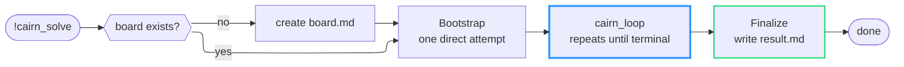
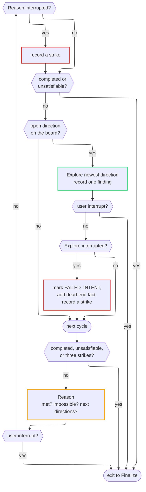

# Common Profile for Enkaidu

> ☝️ COMPATIBILITY - Different sections depend on different Enkaidu features. See each section for its minimum dependency.

> ⚠️ WORK IN PROGRESS, some namespaces are more "in progress" than orders. Stables ones are identified below.

This is an [Enkaidu](https://enkaidu.dev/) "profile" with multiple "purpose-driven" namespaces containint custom prompts, system prompts, and macros. Each namespace provides a consistent way of engaging with it.

- "Enter" via a forked session
- "Init" after entering if using the namespace for the first-time in current project
- "Compact" current session
- "Leave" forked session you _entered_ earlier, which performs namespace-specific closing operations before running compacting and exiting the session.

Additionally, as a convenience, you can "Launch" into a separate session, automatically invoking "Enter" as well.

<!-- TOC -->
**Table of contents**
- [USAGE](#usage)
  - [Clone and symlink](#clone-and-symlink)
  - [Git submodule](#git-submodule)
  - [Download](#download)
- [STABLE](#stable)
  - [Global macros <small>`>= Enkaidu 0.9.10`</small>](#global-macros-small-enkaidu-0910small)
  - [Coding Agents <small>`>= Enkaidu 0.9.10`</small>](#coding-agents-small-enkaidu-0910small)
  - [Skills <small>`>= Enkaidu 0.9.10`</small>](#skills-small-enkaidu-0910small)
- [Experimental](#experimental)
  - [Cairn Solver <small>`>= Enkaidu 0.9.17`</small>](#cairn-solver-small-enkaidu-0917small)
- [Development](#development)
  - [Naming](#naming)
  - [Conventions](#conventions)
- [Contributions, by invitation!](#contributions-by-invitation)
<!-- /TOC -->

## USAGE

An Enkaidu profile for a project lives in the `.enkaidu` folder. This repo contains the files that go **inside** the profile folder.

### Clone and symlink

If you have your own `.enkaidu/` folder with other content, or if you want to share across projects but not commit / include in your codebase / repo, you can do this:

1. Clone the repo somewhere outside your project.
```sh
git clone https://github.com/enkaidu-dev/common-profile.git
```
2. From your project's repo, use `ln -s` to symlink the entire repo as `.enkaidu`, OR create an `.enkaidu/` folder and then symlink in the sub-folders, OR ... you get the idea. ;-)
```sh
# For example
ln -s ../common-profile .enkaidu
```
3. Add `.enkaidu` to your `.gitignore` file

### Git submodule

To use it entirely in your project's Git repo, pull it in as a submodule and map it to `.enkaidu` like so:

```sh
git submodule add https://github.com/enkaidu-dev/common-profile .enkaidu
```

And run the following to pick up updates to the common profile:

```sh
# Pull latest commit from the remote that is tracked by the submodule
git submodule update --remote .enkaidu
```

> 🧐 Tip: You can put the submodule under a different folder and then use symlinks as described in the section above.

### Download

[Download a ZIP file](https://github.com/enkaidu-dev/common-profile/archive/refs/heads/main.zip) of the entire repo and
- Uncompress the archive into a folder, likely one called `common-profile` by default;
- Rename the folder to `.enkaidu`
- Move it into the project where you're using Enkaidu

> 🧐 Tip: You can keep this folder in your home or `Documents` folder and then create an alias (macOS) or short-cut (Windows) or symlink (Linux-likes) to the folder in any and all project folders.

## STABLE

### Global macros <small>`>= Enkaidu 0.9.10`</small>

The profile defines four globally usable macros: **task**, **task_json**, **analyze**, and **brief**. Each macro follows a uniform three‑step workflow: start a fresh session, run a user‑provided query, and then clean up the session while preserving the outline. This design allows the macros to be invoked from any namespace while keeping the execution context isolated and deterministic.

| Action                              | Example                                              | Include history? | Description                                                                                                                                                                                                                                         |
|-------------------------------------|------------------------------------------------------|------------------|-----------------------------------------------------------------------------------------------------------------------------------------------------------------------------------------------------------------------------------------------------|
| Run a task with a full prompt       | `!task "Your prompt"`                                | Yes              | Executes the given prompt in a clean session and returns the session outline.                                                                                                                                                                       |
| Run a task and return JSON response | `!task_json "Your prompt" schema=path/to/schema.yml` | Yes              | Executes the prompt in a clean session and ensures the response conforms to the provided JSON response schema file that conforms to the following structure: `{ "name" : <string>, "description": <string>, "strict": <bool>, "schema": <object> }` |
| Analyze a file (step‑by‑step)       | `!analyze path/to/file.ext`                          | No               | Runs a detailed analysis of the specified file, identifying main points and summarizing them.                                                                                                                                                       |
| Briefly summarize a file            | `!brief path/to/file.ext`                            | No               | Generates a concise bullet‑point summary of the specified file.                                                                                                                                                                                     |
| "Compact" the current session       | `!compactify`                                        | No               | Generates a handoff report based on the current session content and then replaces the session with the handoff. Useful when you're done working on something or when you're in the middle of a goal and running out of context.                     |


### Coding Agents <small>`>= Enkaidu 0.9.10`</small>

Currently we have the following coding agent name spaces.

- `codex.` for macros / prompts based on those from [Codex](https://github.com/openai/codex).
- `dev.` for macros / prompts that we've discovered and evolved while using Enkaidu with smaller local models.

> 👆 If you are running models with <= 32K of tokens in the context, use the `dev.` macros.

Feel free to try both and decide which works for you. You might even want to consider doing some work with one and then switching to the other.

> 👆 While you can mix macros from one namespace after using `.enter` from another, though I suggest sticking to namespace-specific macros after entering a namespace-specific session until you `.leave` that session.

Each namespace (referred to as `NS` below) defines the following actions as macros.

<!-- markdown-table-prettify-ignore-start -->
| Action                                                                                                                                                                                                                                                                                                                                                                                                                                                                        | Example           |
|-------------------------------------------------------------------------------------------------------------------------------------------------------------------------------------------------------------------------------------------------------------------------------------------------------------------------------------------------------------------------------------------------------------------------------------------------------------------------------|-------------------|
| Use `!<NS>.enter` to start a session with the system prompt and configuration for the namespace.                                                                                                                                                                                                                                                                                                                                                                       | `!dev.enter` or `!codex.enter`   |
| Use `!<NS>.init` to initialize your project with an `AGENTS.md` file. This will update one if it already exists.                                                                                                                                                                                                                                                                                                                                                       | `!simple.init`  or `!codex.init`   |
| Use `!<NS>.compact` to create a compact context checkpoint with a hand-off summary. When your session has become long or when you're done with a particular goal or objective, this command can help to reduce the size of the context and keep enough information so that you can start your next thing. **This will replace your current session context with the compact version that is generated in a nested session.**                                           | `!simple.compact` or `!codex.compact` |
| Use `!<NS>.leave` to leave the session started by `!*.enter`. This will perform a compaction using `!*.compact` and then take that context checkpoint / hand-off summary to the parent session. **The parent session _will not be reset_**. You can _enter_ and _leave_ multiple times and collect and gather the checkpoints for the sessions.<br>*Combine this with `/session save ...` and `/session load ...` to persist checkpoints over time if that is useful.* | `!simple.leave` or `!codex.leave`   |
<!-- markdown-table-prettify-ignore-end -->

### Skills <small>`>= Enkaidu 0.9.10`</small>

The goal of these macros is to help understand and use (and create) skills without building the notion of skills into Enkaidu.

A *skill* is any folder under `./.enkaidu/skills/` — at any depth — that directly contains a `SKILL.md` file with YAML front-matter (name, description, etc.). Folders without a `SKILL.md` are just organizational folders used to group skills, not skills themselves. A skill's name is the name of the folder directly containing its `SKILL.md`. For example:

```
.enkaidu/skills/
  +-- about-skills/SKILL.md
  +-- cloudops/
      +-- ops/SKILL.md
  +-- project/
      +-- do-this/SKILL.md
      +-- do-that/SKILL.md
```

Here `about-skills`, `ops`, `do-this`, and `do-that` are skills, while `cloudops` and `project` are just organizational folders.

Two skills are pre-defined as they are used by the skill creator macro:
- `about-skills`
- `skill-creator`

The following macros related to skills are available to play with.

| Action                   | Example                  | Include history? | Description                                                                                                                                                                                                                                                                                                                                     |
|--------------------------|--------------------------|------------------|-------------------------------------------------------------------------------------------------------------------------------------------------------------------------------------------------------------------------------------------------------------------------------------------------------------------------------------------------|
| Initialize skills        | `!skill.init`            | Yes              | Prepares the session to work with skills: lists the available skills (via `!skill.list`) and loads the `about-skills` skill so its guidance is in context.                                                                                                                                                                                      |
| List available skills    | `!skill.list`            | No               | Recursively finds every `SKILL.md` under `./.enkaidu/skills` (at any depth) and outputs a JSON array where each element contains the full path to that `SKILL.md` plus the front‑matter fields (name, description, etc.).                                                                                                                       |
| Use a skill by its name  | `!skill.use SKILLNAME`   | N/a              | Loads the named skill into the current session. Searches recursively under `./.enkaidu/skills` for a folder named `SKILLNAME` containing a `SKILL.md`, stops and reports if none is found, otherwise outputs a concise summary of the skill and next‑step instructions if applicable.                                                           |
| Create your own skill    | `!skill.create "Prompt"` | Yes              | Initiates a 2‑level nested session to create a new skill from the quoted prompt. It loads `about-skills` and `skill-creator`, researches the topic (with Web content retrieval preferred as markdown), proposes candidate names, and after confirmation automatically creates the skill folder and files, then returns to the original session. |
| Review an existing skill | `!skill.review "Prompt"` | Yes              | Initiates a 2‑level nested session to review and update an existing skill based on the quoted prompt. It stops immediately if the described skill doesn't exist; otherwise it loads the skill and researches the topic (with Web content retrieval preferred as markdown) to improve it.                                                        |

## Experimental

### Cairn Solver <small>`>= Enkaidu 0.9.17`</small>

Searches for a path from a known starting point to a verifiable goal when the
steps in between are not known in advance. Modelled on the Cairn engine: findings
accumulate on a shared board, and fresh worker sessions decide what to try next
from what is already confirmed.

```
!cairn_solve name="<project>" origin="<starting point>" goal="<checkable end condition>"
```

#### What it does

The macro, not the model, runs the loop. For each step it forks a clean session,
gives the model one narrow role, and discards the session afterwards. Workers
share nothing except the board file, so every decision is visible there.

| Role      | Job                                                                                     |
|-----------|-----------------------------------------------------------------------------------------|
| Bootstrap | One direct attempt to reach the goal before any search                                  |
| Reason    | Reads the whole board; declares the goal met or impossible, or proposes next directions |
| Explore   | Takes the newest open direction, works it, records exactly one finding                  |
| Recovery  | Runs only after an interrupted worker; fails the direction and records a strike         |
| Finalize  | Writes a summary with the terminal status                                               |

All state lives under `tmp/cairn/<name>/`:

| File        | Contents                                                                  |
|-------------|---------------------------------------------------------------------------|
| `board.md`  | Append-only record of facts and directions, ending with an `<END>` anchor |
| `strikes`   | One `X` per interrupted worker; three stop the run                        |
| `scratch/`  | Scripts workers wrote, named after the direction they served              |
| `result.md` | Final summary                                                             |

The board uses four line types. `FACT` lines are confirmed findings, each naming
the facts it was derived from (`[from=...]`), which makes the board an audit
trail. `OPEN_INTENT` lines are directions not yet tried; `DONE_INTENT` and
`FAILED_INTENT` lines are closed.

The run ends in one of four states, reported in `result.md`:

| Status        | Meaning                                          |
|---------------|--------------------------------------------------|
| ACHIEVED      | The facts satisfy the goal                       |
| UNSATISFIABLE | The facts prove the goal can never be met        |
| ABORTED       | Three workers were interrupted (circuit breaker) |
| INCOMPLETE    | Stopped by the user, or ended without a verdict  |

A run is resumable: invoking it again with the same `name` continues from the
existing board.

#### How it works

Overview:



<details>
<summary>One cycle of `cairn_loop`:</summary>



Each box that runs a model is a separate, clean session. Interrupts come from the
harness tripwire, which stops a worker whose output collapses into repetition.

</details>

#### Writing good invocations

1. **Make the goal checkable.** "MFA is enforced on every admin route" works;
   "improve security" gives Reason nothing to judge against.
2. **For ordered work, say so.** Explore always takes the newest direction, so
   steps that depend on each other need "propose only the next step whose input
   already exists" in the origin.
3. **Describe steps in prose, not code.** Quotes and backticks in the origin can
   get mangled when written to the board. Let workers write their own scripts.
4. **Keep the board's markers out of the text.** Avoid the literal strings
   `<END>`, `OPEN_INTENT`, `@@COMPLETED@@` and `@@UNSATISFIABLE@@` in the origin
   and goal; describe them in words if you must.
5. **Don't put reply-format instructions in the origin.** Workers read the board
   as data and may ignore instructions about how to respond.

#### Examples

##### Root-cause debugging

```
!cairn_solve name="flaky-orders" origin="Integration test spec/orders_spec.cr fails roughly one run in ten. Run it repeatedly and vary one condition at a time (seed, parallelism, timezone, database state) to narrow the cause. Record each experiment as a fact, including the ones that changed nothing." goal="A specific condition reproduces the failure at least four times out of five, and a fact explains the mechanism."
```

ACHIEVED gives a reproduction and its cause, with ruled-out conditions on the board. UNSATISFIABLE means the failure could not be reproduced under any tried condition, which is a bounded, useful result.

##### Vulnerability reachability

```
!cairn_solve name="cve-reach" origin="Our service depends on a library with a published flaw in its XML parser. Establish, one link at a time: is the vulnerable version in the lockfile; is the parser imported; is it called on a code path reachable from an HTTP handler; can request data reach that call. Propose only the next link once the previous one is confirmed." goal="Either a confirmed chain from an HTTP handler to the vulnerable call, or a confirmed link in the chain that is absent."
```

ACHIEVED returns the call chain. UNSATISFIABLE records exactly which link is missing, which is usually what closes the ticket.

##### Compliance evidence

```
!cairn_solve name="cc61-q3" origin="Gather evidence for access-control requirement CC6.1 in the staging environment: production database credentials are stored only in the secrets manager, rotated within 90 days, and readable only by the service role. Check each part separately and record what was inspected." goal="Each of the three parts has a fact showing it holds, citing what was inspected."
```

The board doubles as the evidence package, with each conclusion pointing at the facts beneath it. UNSATISFIABLE names the specific part that fails.

##### Incident triage

```
!cairn_solve name="alert-4417" origin="Alert 4417 reports an unusual outbound connection from build runner 3 at 02:14. Logs are under ./incident/4417. Pivot from what each finding reveals: process, parent, user, file changes, other hosts contacted." goal="Either the connection is explained by a known, legitimate process, or the full set of affected hosts and the initial entry point are identified."
```

The board becomes the incident timeline, including the leads that went nowhere, which shows the investigation was thorough rather than merely asserting it.

##### Claim verification

```
!cairn_solve name="claim-latency" origin="Our README states that request latency dropped 40% after release 2.3. Using the benchmark results in ./bench, compare like-for-like runs before and after 2.3 and record each comparison." goal="Either the comparisons support a drop of at least 40%, or they show the claim does not hold, with the measured figure."
```

#### Limitations

- Runs one worker at a time; it trades speed for a complete record.
- Each worker reads the whole board, so very long searches will strain smaller models.
- Workers count lines to assign ids, which may drift on boards with many dozens of facts.
- Control markers live in the board text, so findings that contain them can disrupt the run.
- Token and time caps are not yet enforced; a worker that hangs silently must be stopped by hand.

## Development

An [Enkaidu profile](https://enkaidu.dev/docs/using_enkaidu/profiles/) can have prompts, system prompts, and macros in single respectively named YAML files, or as many YAML files within respectively named folders.

This repository contains folders:

| Folder            | Description                                              |
|-------------------|----------------------------------------------------------|
| `macros/`         | Contains macros in functionally names YAML files         |
| `prompts/`        | Contains prompts in functionally names YAML files        |
| `system_prompts/` | Contains system prompts in functionally names YAML files |

### Naming

Enkaidu doesn't support namespaces syntactically. Instead we use a period `'.'` in the name of prompts, system prompts and macros to separate the namespace from their functional names, like so: `<NAMESPACE>.<FUNCTION>`

E.g. `codex.init` vs `simple.init`

### Conventions

1. When macros, prompts, and system_prompts are related, there should be a file with the same name in each folder so that it's clear the capabilities are related.

2. Within such files, consider a unique prefix for all those entities.

See the `simple.yml` files under each folder to get a sense of the naming and name-spacing.

## Contributions, by invitation!

*With apologies*, at this time contributions are *by invitation only* and limited to people I know and see often.

These are early days for Enkaidu and I am busy with family and work.

At this time I want to work on this at a manageable pace.
